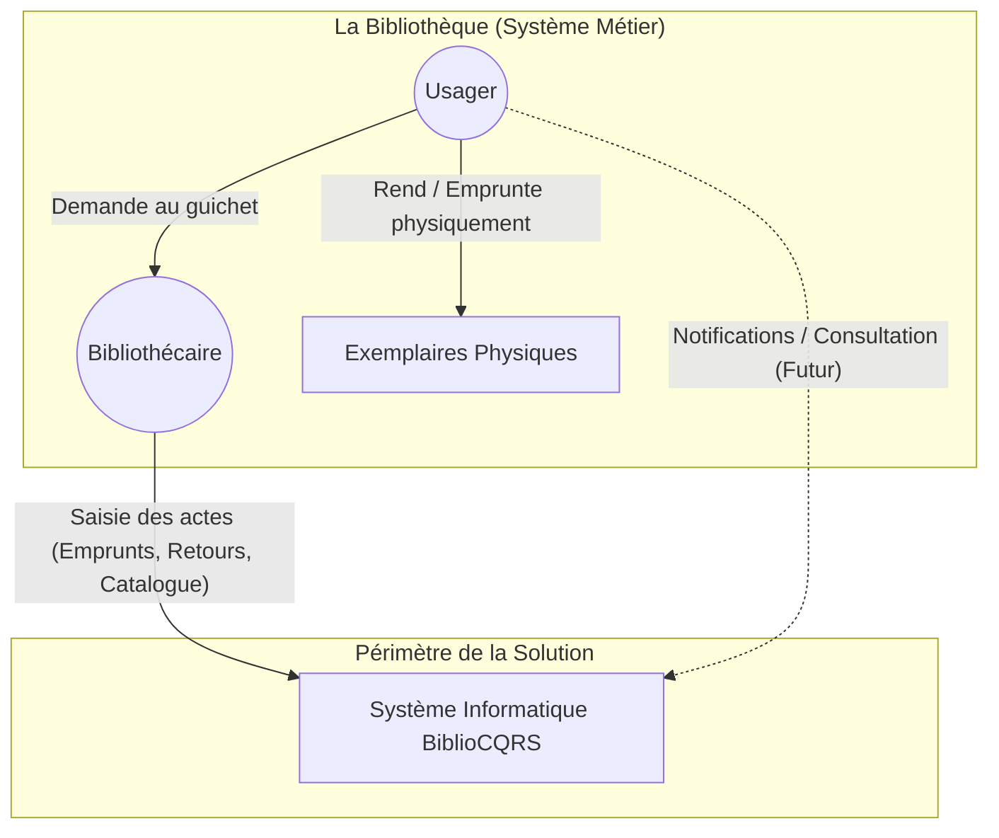

# Contexte

## Diagramme

- Diagramme repris tel quel (document : SRC-001, 1.3 Diagramme de Contexte du Système) [hypothèse]

## Systèmes externes et flux

- La Bibliothèque (système métier, réalité physique) se distingue du Système de Gestion informatisé BiblioCQRS ; le périmètre d'étude est uniquement BiblioCQRS (document : SRC-001, 1.3 Diagramme de Contexte du Système) [hypothèse]
- Le bibliothécaire saisit les actes (emprunts, retours, catalogue) dans BiblioCQRS (document : SRC-001, 1.3 Diagramme de Contexte du Système) [hypothèse]
- L'usager rend ou emprunte physiquement les exemplaires et fait ses demandes au guichet auprès du bibliothécaire (document : SRC-001, 1.3 Diagramme de Contexte du Système) [hypothèse]
- L'usager recevra des notifications et consultera BiblioCQRS : flux marqué « Futur » (document : SRC-001, 1.3 Diagramme de Contexte du Système) [hypothèse]
- Le système informatique n'interagit pas directement avec les livres ; il est alimenté par les actions du bibliothécaire, qui sert d'interface de saisie pour la réalité physique (document : SRC-001, 1.3 Diagramme de Contexte du Système) [hypothèse]

## Questions ouvertes

- Existe-t-il des systèmes externes (messagerie pour les notifications, annuaire, comptabilité) ? Aucun n'est cité (vu dans SRC-001, 1.3 Diagramme de Contexte du Système)
